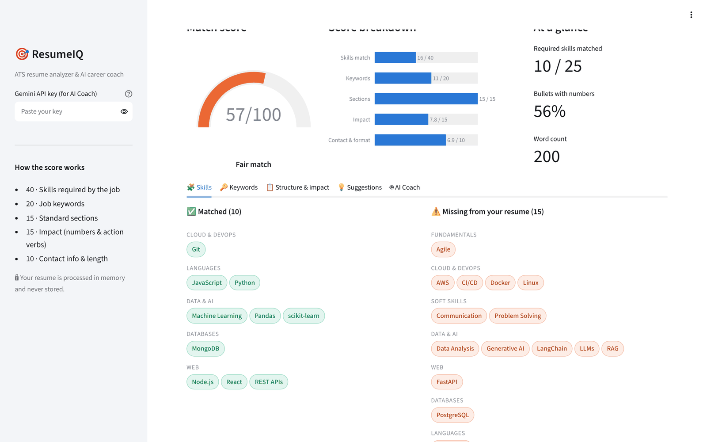
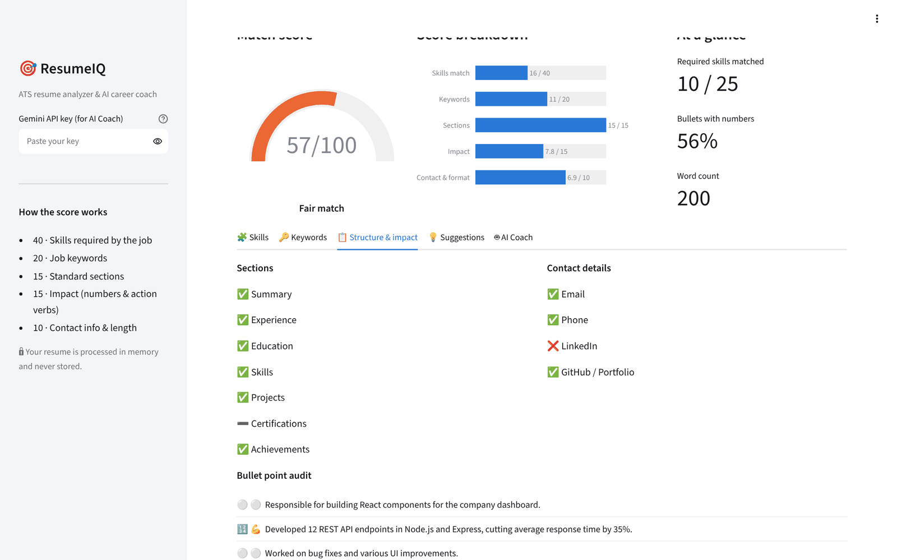
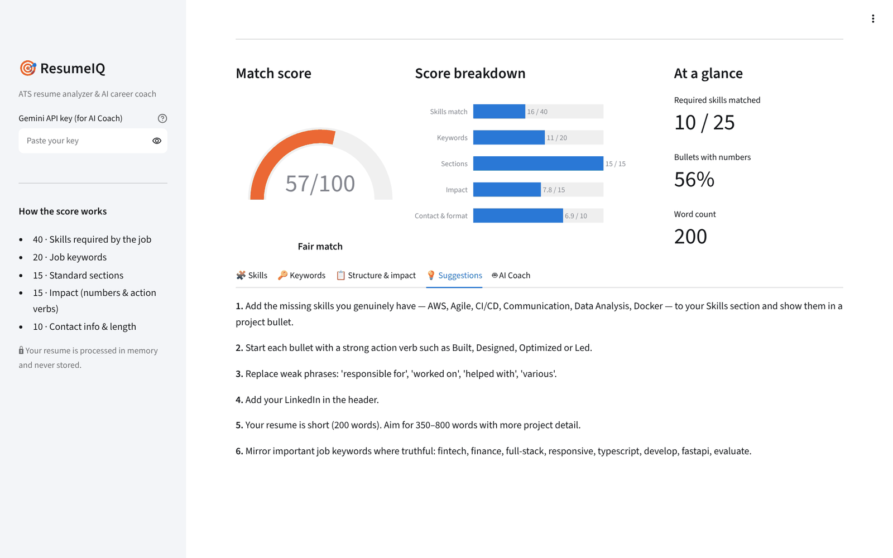

<div align="center">

# 🎯 ResumeIQ

### ATS resume analyzer & AI career coach — will your resume pass the robot?

[](https://github.com/umeshgoingtohienght/resumeiq/actions/workflows/ci.yml)


[](https://YOUR-RESUMEIQ-APP.streamlit.app)



</div>

---

## 💡 The problem

Most companies filter resumes with an **Applicant Tracking System (ATS)** before a human ever reads them. Good candidates get rejected because their resume is missing the job's keywords, uses non-standard section names, or describes work without measurable impact.

**ResumeIQ** compares a resume with a job description and explains — line by line — what to fix.

## ✨ Features

| | |
|---|---|
| 📊 **Match score (0–100)** | Transparent, rule-based score broken into 5 parts — no black box |
| 🧩 **Skill gap analysis** | 80+ skills with aliases (`ReactJS → React`, `k8s → Kubernetes`, `GitHub Actions → CI/CD`), grouped by category |
| 🔑 **Keyword coverage** | Finds the job's most important words; ignores company names and cities automatically |
| 📋 **Structure check** | Detects standard sections (`Work Experience:`, `TECHNICAL SKILLS`, …) and contact details |
| 💪 **Bullet-point audit** | Flags bullets without numbers or action verbs and weak phrases like *"responsible for"* |
| 🤖 **AI Coach (optional)** | Gemini writes a tailored summary, rewrites weak bullets, predicts interview questions and builds a learning plan — using **structured JSON output** |
| 📄 **PDF, DOCX & TXT** | Robust text extraction with bullet-glyph normalisation |
| 🔒 **Private** | Files are processed in memory and never stored; API key never sent to the browser |

> The ATS analysis works **offline without any API key**. The AI Coach is a bonus layer on top.

## 📸 Screenshots

| Bullet-point audit | Actionable suggestions |
|:---:|:---:|
|  |  |

## 🧮 How the score works

| Component | Weight | What is measured |
|-----------|:-----:|------------------|
| Skills match | 40 | Share of the job's required skills found in the resume |
| Keywords | 20 | Coverage of the job's 20 most frequent meaningful words |
| Sections | 15 | Experience, Education, Skills and Projects headings present |
| Impact | 15 | Bullets with numbers (target ≥ 50 %) and action verbs (target ≥ 70 %), minus weak phrases |
| Contact & format | 10 | Email, phone, LinkedIn, GitHub, and a healthy length (300–900 words) |

## 🏗️ Architecture

```
Resume (PDF/DOCX/TXT) ──▶ parser.py ──▶ clean text ─┐
                                                     ├──▶ analyzer.py ──▶ Report (score, gaps, tips) ──▶ Streamlit UI
Job description ─────────────────────────────────────┘          │
                                                                 └──▶ ai.py (Gemini, JSON schema) ──▶ AI Coach tab
```

```
resumeiq/
├── app.py                 # Streamlit UI (Plotly gauge & breakdown)
├── src/
│   ├── parser.py          # PDF / DOCX / TXT extraction
│   ├── skills.py          # Skills taxonomy + context-aware matcher
│   ├── analyzer.py        # Scoring, keyword extraction, suggestions
│   └── ai.py              # Gemini coach with structured output
├── samples/               # Fictional resume + job description for the demo
└── tests/test_analyzer.py # 9 unit tests
```

## ⚡ Quick start

```bash
git clone https://github.com/umeshgoingtohienght/resumeiq.git
cd resumeiq
python -m venv venv && source venv/bin/activate   # Windows: venv\Scripts\activate
pip install -r requirements.txt
cp .env.example .env        # optional: add GEMINI_API_KEY for the AI Coach
streamlit run app.py
```

Toggle **"Try with a sample resume"** to see a full analysis instantly. Run tests with `pytest -v`.

## 🧠 Interesting engineering problems

- **False positives in skill matching** — words like *"rest"*, *"go"* or *"node"* are common English. Ambiguous aliases only count when written as an acronym (`REST`) or inside a list (`, Node,`).
- **Proper-noun filtering** — words that are *always* capitalised in a job post (company names, cities) are excluded from keywords, so the tool never tells you to add *"Bengaluru"* to your resume.
- **PDF bullet glyphs** — different PDF generators encode `•` as `\x7f`, `` and others; they are normalised before analysis.

## 🛣️ Roadmap

- [ ] Semantic matching with embeddings (e.g. "built REST services" ≈ "API development")
- [ ] Compare one resume against many jobs
- [ ] Export an improved resume as DOCX

## 📜 License

[MIT](LICENSE)

---

<div align="center">Made with ❤️ by <a href="https://github.com/umeshgoingtohienght">Umesh Meena</a> · ⭐ Star this repo if it helped you!</div>
